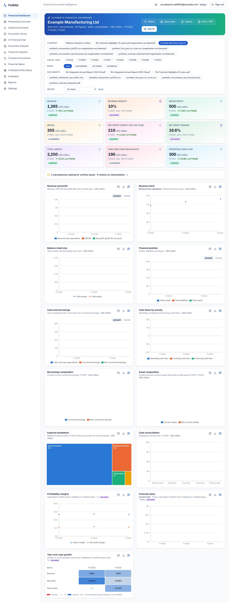
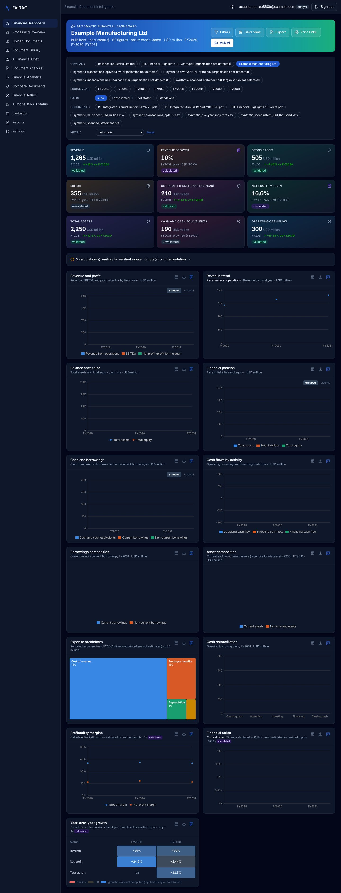
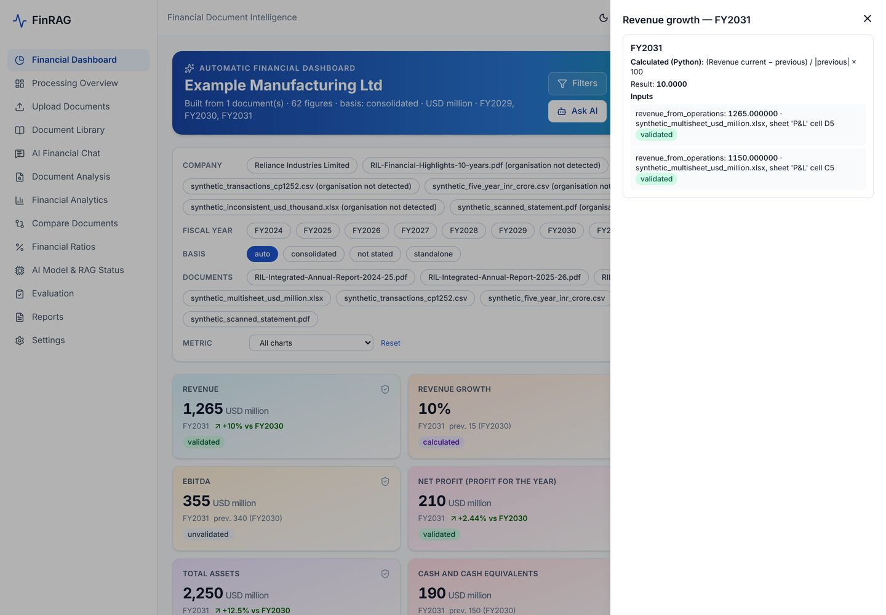
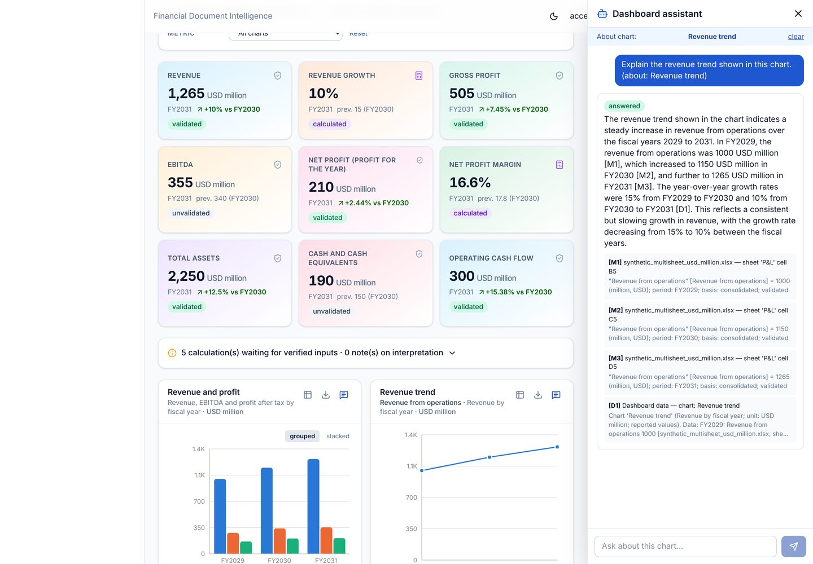
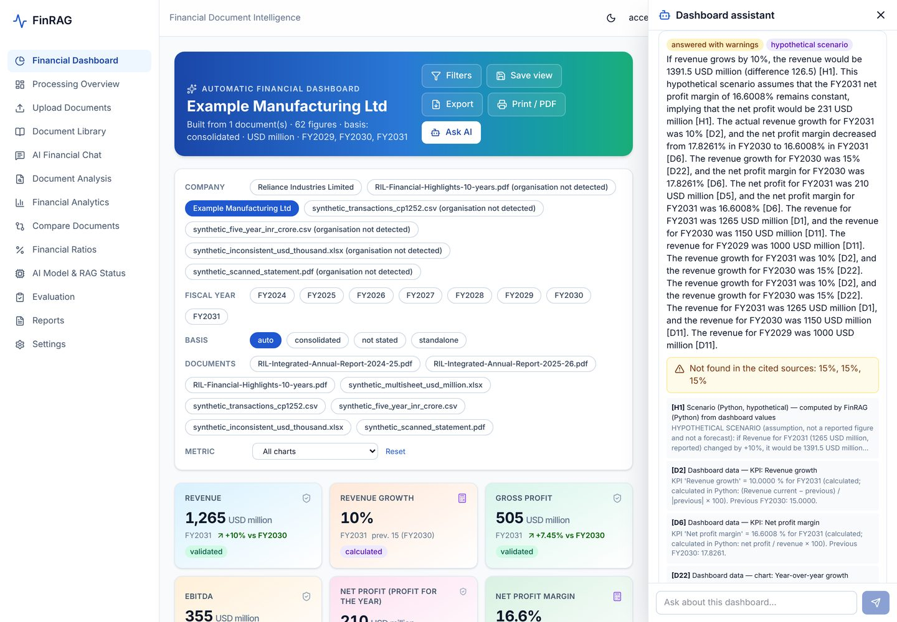
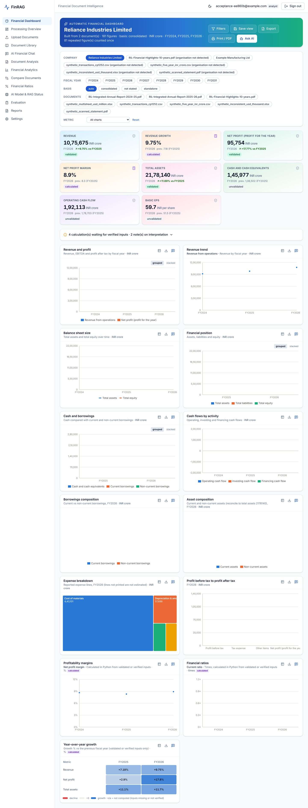

# Acceptance Tests

**Final run:** 2026-11-24 10:21:53 UTC → 2026-11-24 10:33:40 UTC · **Result: 48/48 checks passed** · runner: [`backend/scripts/acceptance_run.py`](../backend/scripts/acceptance_run.py) · inputs: [`backend/scripts/make_acceptance_files.py`](../backend/scripts/make_acceptance_files.py)

Every result below was produced by the live stack (FastAPI, worker, PostgreSQL, Qdrant, llama.cpp with Qwen3-4B on CPU, Next.js) for a **fresh user** who uploaded all files through the API. Expected values come from the ground truth of the synthetic files, from the printed genuine reports, or from arithmetic done independently in the runner. Nothing is estimated.

## Inputs

| Key | File | Kind | Processed: metrics / chunks |
|---|---|---|---|
| ril_2425 | `RIL-Integrated-Annual-Report-2024-25.pdf` | genuine annual report (PDF, 2024-25) | 345 / 751 |
| ril_2526 | `RIL-Integrated-Annual-Report-2025-26.pdf` | genuine annual report (PDF, 2025-26) — overlaps FY2025 | 456 / 773 |
| ril_scan | `RIL-Financial-Highlights-10-years.pdf` | genuine 10-year highlights (image-only PDF → OCR) | 22 / 3 |
| xlsx | `synthetic_multisheet_usd_million.xlsx` | synthetic workbook: P&L, Balance Sheet (2 tables), Cash Flow, Summary links; USD million; formulas cached | 64 / 11 |
| tx_csv | `synthetic_transactions_cp1252.csv` | synthetic transactions: `;`-delimited, Windows-1252, decimal comma, a duplicate row, a missing amount | 3 / 5 |
| docx | `synthetic_notes_borrowings.docx` | synthetic notes: revenue explanation, borrowings table, risks (USD million) | 6 / 5 |
| five_csv | `synthetic_five_year_inr_crore.csv` | synthetic five-year summary FY2027–FY2031, INR crore | 20 / 3 |
| bad_xlsx | `synthetic_inconsistent_usd_thousand.xlsx` | synthetic, deliberately inconsistent (balance sheet and cash roll-forward) | 6 / 4 |
| scan_pdf | `synthetic_scanned_statement.pdf` | synthetic statement rendered as an image-only PDF (OCR) | 8 / 1 |

Synthetic files state inside them that they are invented test data. Processing all nine took 320 s.

## Results by acceptance criterion

| # | Criterion | Check | Result |
|---|---|---|---|
| 0 | Processing | all 9 documents processed | PASS |
| 1 | Extracts the correct figures | multi-sheet workbook: every ground-truth P&L, balance sheet and cash-flow value extracted exactly once and correctly | PASS |
| 1 | Extracts the correct figures | workbook formula cell (Gross profit = revenue − COGS) read from its cached value 505 | PASS |
| 1 | Extracts the correct figures | Summary-sheet cross-sheet links recognised as copies (not counted again) | PASS |
| 1 | Extracts the correct figures | genuine report: consolidated revenue from operations FY2025 = 9,80,136 crore | PASS |
| 1 | Extracts the correct figures | genuine report: consolidated total assets 31 March 2025 = 19,50,121 crore | PASS |
| 1 | Extracts the correct figures | genuine 2025-26 report: its FY2025 comparative figures match the 2024-25 report (consistency across real documents) | PASS |
| 1 | Extracts the correct figures | scanned (image-only) statement read by OCR: revenue 880, PBT 180, profit 135 for FY2031 | PASS |
| 1 | Extracts the correct figures | OCR values are flagged needs_review (never silently trusted) | PASS |
| 2 | Preserves source references | synthetic_multisheet_usd_million.xlsx: 12/12 sampled values found at their cited location in the original file | PASS |
| 2 | Preserves source references | synthetic_notes_borrowings.docx: 6/6 sampled values found at their cited location in the original file | PASS |
| 2 | Preserves source references | synthetic_five_year_inr_crore.csv: 12/12 sampled values found at their cited location in the original file | PASS |
| 2 | Preserves source references | synthetic_scanned_statement.pdf: 8/8 sampled values found at their cited location in the original file | PASS |
| 2 | Preserves source references | RIL-Integrated-Annual-Report-2024-25.pdf: 12/12 sampled values found at their cited location in the original file | PASS |
| 2 | Preserves source references | RIL-Integrated-Annual-Report-2025-26.pdf: 12/12 sampled values found at their cited location in the original file | PASS |
| 2 | Preserves source references | transactions CSV: ';' delimiter, cp1252 encoding, decimal comma, duplicate row 5 and missing amount reported | PASS |
| 2 | Preserves source references | workbook structure kept: 4 sheets, 2 tables on 'Balance Sheet', cross-sheet links Summary→P&L and Summary→Balance Sheet | PASS |
| 3 | Maps the correct financial years | fiscal years: 'FY2031' → 2031, 'As at 31 March 31' → 2031, '2024-25' → 2025 | PASS |
| 3 | Maps the correct financial years | five-year CSV mapped to FY2027…FY2031 | PASS |
| 4 | Handles different units and currencies | currencies detected: USD (xlsx, docx), EUR (CSV), INR (five-year CSV) | PASS |
| 4 | Handles different units and currencies | units detected: million, million, crore, thousand | PASS |
| 4 | Handles different units and currencies | normalised value = printed value × unit (1265 million → 1,265,000,000) | PASS |
| 4 | Handles different units and currencies | decimal-comma amounts summed correctly by category in Python (Rent 3600.00, Travel 1130.50, Software 410.25) | PASS |
| 5 | Calculates ratios correctly | net profit margin FY2031 = 210/1265×100 = 16.6008 | PASS |
| 5 | Calculates ratios correctly | revenue growth FY2031 = (1265−1150)/1150×100 = 10.0000 | PASS |
| 5 | Calculates ratios correctly | gross margin FY2031 = 505/1265×100 = 39.9209 | PASS |
| 5 | Calculates ratios correctly | debt-to-equity FY2031 = printed total borrowings 520 (reconciles with 100 + 420) / equity 1050 = 0.4952, from validated inputs only | PASS |
| 5 | Calculates ratios correctly | EBITDA margin not computed while EBITDA is unvalidated (pending, never guessed) | PASS |
| 6 | Detects reconciliation errors | balance sheet that does not balance and broken cash roll-forward are both detected | PASS |
| 6 | Detects reconciliation errors | the inconsistent values are marked failed_validation | PASS |
| 6 | Detects reconciliation errors | consistent workbook passes the new checks (gross profit, PBT = PAT + tax, cash roll-forward, net change = three activities) | PASS |
| 7 | Creates dashboards from available data | dashboard generated automatically from the workbook + notes (KPIs and charts) | PASS |
| 8 | Generates suitable charts | chart families chosen from the data: line/grouped bar trends, area, donut, pie, waterfall, treemap, heatmap | PASS |
| 8 | Generates suitable charts | cash waterfall: 150 → +300 −180 −80 → 190 with no unexplained remainder | PASS |
| 9 | Does not block analysis when optional metrics are missing | a document without statement metrics (transactions) does not break the dashboard | PASS |
| 9 | Does not block analysis when optional metrics are missing | five-year summary: revenue, profit, assets KPIs and a 5-point revenue line even though EBITDA, equity, cash flow are absent | PASS |
| 10 | Does not fabricate missing data | failed (inconsistent) values never reach KPIs or charts | PASS |
| 10 | Does not fabricate missing data | no KPI for metrics the document does not contain (no EBITDA, cash, borrowings, debt-to-equity) | PASS |
| 10 | Does not fabricate missing data | calculations on unvalidated inputs are listed as pending, not shown | PASS |
| 10 | Does not fabricate missing data | question about a period that is not in the documents (FY2035) is withheld, no figure invented | PASS |
| 11 | Answers questions about dashboard charts | chart question answered from the chart's data points with [D#] citations and no unsupported numbers | PASS |
| 12 | Explains calculations with evidence | scenario: Python result 1391.5 cited as hypothetical [H#], not presented as reported | PASS |
| 12 | Explains calculations with evidence | calculation explained with its formula and cited inputs | PASS |
| 12 | Explains calculations with evidence | explanation question uses the Word note (document passage cited) or says the documents do not explain it | PASS |
| 13 | Handles multiple documents without double counting | same figures in workbook and Word notes (borrowings FY2031) counted once | PASS |
| 13 | Handles multiple documents without double counting | two genuine annual reports: FY2025 appears once in the revenue trend, repeated comparatives de-duplicated | PASS |
| 14 | Deletes associated data correctly | deleting the Word notes removes its vectors, and the dashboard no longer cites it while the workbook values remain | PASS |
| 15 | Works within the hardware and context limits | every dashboard prompt fits the 8,192-token context (max 4377 prompt tokens) | PASS |

## Dashboard conversation with the real model (final run)

| Question | Status | Citations | Unsupported numbers flagged | Prompt tokens | Seconds |
|---|---|---|---|---|---|
| Explain the revenue trend shown in this chart. | answered | M1, M2, M3, D1, S1 | — | 3832 | 105.0 |
| What happens if revenue grows by 10%? | answered_with_warnings | H1, D1, D2, M1 | 15% | 3666 | 94.0 |
| How was the net profit margin calculated, and from which inputs? | answered | D6, D5, D1 | — | 4377 | 81.7 |
| Why did revenue increase in FY2031? | answered | S1, D1 | — | 4043 | 62.8 |
| What was EBITDA in FY2035? | insufficient_evidence | — | — | 4084 | 33.6 |

Answers, verbatim:

- **Explain the revenue trend shown in this chart.** — The revenue trend shown in the chart indicates a steady increase in revenue from operations over the fiscal years 2029 to 2031. Revenue from operations was 1000 USD million in FY2029 [M1], increased to 1150 USD million in FY2030 [M2], and further rose to 1265 USD million in FY2031 [M3]. The year-over-year growth rates were 15% from FY2029 to FY2030 and 10% from FY2030 to FY2031 [D1]. This growth is primarily attributed to the company's expansion in the industrial segment through new long-term supply contracts, which contributed to an increase in revenue [S1].
- **What happens if revenue grows by 10%?** — If revenue grows by 10%, the revenue would be 1391.5 USD million (difference 126.5) [H1]. This hypothetical scenario is based on the assumption that the FY2031 net profit margin of 16.6008% remains constant, implying a net profit of 231 USD million [H1]. The actual revenue growth for FY2031 was 10%, leading to a revenue of 1265 USD million [D1]. The revenue growth for FY2030 was 15%, resulting in a revenue of 1150 USD million [D2]. The revenue from operations for FY2029 was 1000 USD million [M1].
- **How was the net profit margin calculated, and from which inputs?** — The net profit margin was calculated using the formula: net profit / revenue × 100. For FY2031, the net profit margin is 16.6008% [D6]. This value is calculated in Python from validated inputs, where the net profit is 210 USD million [D5] and the revenue is 1265 USD million [D1]. The calculation is based on the reported values from the financial statements [D6].
- **Why did revenue increase in FY2031?** — The revenue increased in FY2031 mainly because of two new long-term supply contracts signed in the industrial segment; prices were broadly unchanged [S1]. This is supported by the revenue from operations for FY2031 being 1265 USD million, which is a 10% increase from the previous year's 1150 USD million [D1].
- **What was EBITDA in FY2035?** — Sufficient evidence was not found in the selected documents. The sources provided do not contain any information about EBITDA in FY2035.

**Reading these honestly.** The chart, calculation and explanation answers are correct and fully cited (the revenue explanation comes from the Word note, cited as a document passage). In the scenario answer the model also restated the FY2030 growth of 15%, citing [D2] — the “Revenue growth” KPI, whose text says “Previous FY2030: 15.0000”. The verifier flagged “15%” as unsupported because it compared the digits 15 with 150000. That was a **verifier false positive**, found from this run and fixed afterwards (a source decimal with an all-zero fraction now also matches its integer; substring matches such as 200 inside 2,00,500 are still rejected — `test_integer_matches_source_decimal_with_zero_fraction_only`). The scenario screenshot below was taken before that fix and still shows the warning. Separately, the 4B model can reason clumsily: in run 1 it described the actual 10% growth as “lower than” a hypothetical 10%, and in the screenshot it repeats itself. Verification checks numbers and citations, not reasoning.

**Hardware:** 4 vCPU, 15.7 GB RAM, no GPU; Qwen3-4B Q4_K_M via llama.cpp (CPU), context 8192. Answer times: 105.0, 94.0, 81.7, 62.8, 33.6 s. The largest dashboard prompt was 4377 tokens (the dashboard context is capped to fit the 8,192-token window).

## Genuine reports

FY2025 consolidated figures printed in the 2025-26 report (as comparatives) equal those in the 2024-25 report: revenue_from_operations 9,80,136, total_assets 19,50,121, total_equity 10,09,626, net_profit 81,309; no differences.

Dashboard over both reports: 557 extracted values considered, 181 used; 81 repeated figures counted once; 132 alternative values that differ from the value used (other tables, restated comparatives or extractions to review) are listed with each data point. Key figures:

| KPI | Value | Unit | FY |
|---|---|---|---|
| Revenue | 1075675 | crore | 2026 |
| Revenue growth | 9.7475 | % | 2026 |
| Net profit (profit for the year) | 95754 | crore | 2026 |
| Net profit margin | 8.9018 | % | 2026 |
| Total assets | 2178140 | crore | 2026 |
| Cash and cash equivalents | 145977 | crore | 2026 |
| Operating cash flow | 192113 | crore | 2026 |
| Basic EPS | 59.69 | per share | 2026 |

## Run history

| Run | Result | Failures | What changed afterwards |
|---|---|---|---|
| 1 | 43/47 | [5] debt-to-equity not computed while borrowings are unverified (needs_verification), never guessed; [8] chart families chosen from the data: line/grouped bar trends, area, donut, pie, waterfall, treemap, heatmap; [13] same figures in workbook and Word notes (borrowings FY2031) counted once; [11] chart question answered from the chart's data points with [D#] citations and no unsupported numbers | Sub-tables without a basis heading (the workbook's borrowings table, the Word note) were 'basis not stated', so they never joined the consolidated view: basis is now inherited when a document is unambiguous (`metric_extractor.inherit_basis`). Trend charts now carry year-over-year changes computed in Python so the model does not compute them. |
| 2 | 46/47 | [5] debt-to-equity not computed while borrowings are unverified (needs_verification), never guessed | Not a defect: with the notes' printed total borrowings (520) now reconciled to its components (100 + 420) and validated, debt-to-equity 520/1050 = 0.4952 is correctly computed. The check was rewritten to assert that value and its validated inputs, plus a new check that EBITDA margin stays pending while EBITDA is unvalidated. |
| 3 | 48/48 | — | final |

Defects found while preparing these tests and fixed before the runs: CSV rows silently dropped after a title line; units such as “Amounts in USD million” not detected; cross-sheet link cells counted as new figures; explicit short/long-term borrowings ignored without a section heading; `#` comment lines breaking delimiter detection; decimal commas; noisy generic total check; EBIT and “cash generated from operations” mapped to different measures. See `docs/PRODUCT_GAP_ANALYSIS.md` §F.

## Screenshots (actual interface, acceptance user, after the final run)

The final run ends by deleting the Word notes (criterion 14), so these views show the workbook alone: total borrowings and debt-to-equity, which depended on the notes, are correctly no longer shown.

### Automatic dashboard — one organisation, light theme



### Same dashboard, dark theme



### Drill-down: a calculated KPI shows its Python formula and each input's cell and validation status



### Dashboard assistant answering about the Revenue trend chart, citing workbook cells and dashboard data



### Hypothetical scenario computed in Python and labelled as such



### Dashboard built from the two genuine annual reports



## Reproduce

```bash
cd backend && FINRAG_TEST_DOCS=/path/to/genuine/reports ACC_OUT=/tmp/acceptance.json .venv/bin/python scripts/acceptance_run.py
```

The runner needs the genuine reports named in its `files` mapping (not in the repository), LibreOffice (to cache formula values in the synthetic workbook, as Excel would) and Tesseract.
