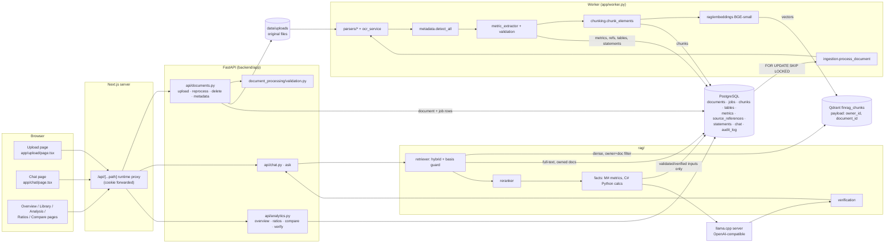
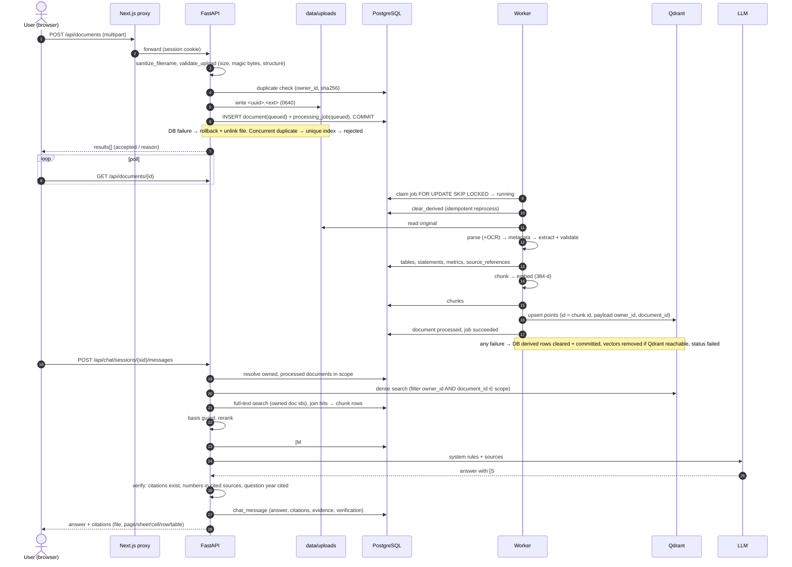

# End-to-End Data Flow Audit

**Date:** 2026-11-24 · **Scope:** one newly uploaded document, traced from the browser to a verified answer on screen.
**Method:** code review of every stage, plus a live audit of the running stack (FastAPI, worker, PostgreSQL 16, Qdrant 1.20,
llama.cpp with Qwen3-4B on CPU, Next.js 16). The live audit is reproducible with
[`backend/scripts/e2e_data_flow_audit.py`](../backend/scripts/e2e_data_flow_audit.py) and the browser test
[`frontend/e2e/smoke.mjs`](../frontend/e2e/smoke.mjs).

All results below are from real runs on this date. Nothing is estimated. Where a check failed, the failure, its cause and the fix
are recorded (§6).

---

## 1. Architecture



## 2. Sequence: one upload, one question



## 3. Stage-by-stage trace

Paths are relative to `backend/app/` unless they start with `frontend/`. "Test" lists the automated tests (`backend/tests/`) and the
live-audit checks (§5) that exercise the stage.

| # | Stage | File · function | Input → Output | Storage | Error handling | Tests |
|---|---|---|---|---|---|---|
| 1 | Frontend upload | `frontend/app/upload/page.tsx` · `UploadPage.add`, `upload`, `poll` | Files chosen by the user (extension pre-filter) → `FormData` `files[]` → per-file results; polls real status | none (browser) | Unsupported types listed and not sent; API errors shown; status read from the API, never simulated | `frontend/e2e/smoke.mjs` (upload, accepted, processing finished) |
| 1a | Proxy | `frontend/app/api/[...path]/route.ts` | Browser request → same request to `BACKEND_URL` with cookie | none | Upstream status and body passed through | smoke test; live: 76 s chat request via proxy → 200 |
| 2 | Upload endpoint | `api/documents.py` · `upload` | multipart files (≤ `max_files_per_request`) → `{"results":[{accepted, document \| error}]}` | — | 413 on too many files; per-file rejection with reason; audit log entry `document.upload` / `document.upload_rejected`; RBAC `require("upload")` | `test_upload_validation_and_multi_upload`, `test_rbac_viewer_cannot_upload` |
| 3 | File validation | `document_processing/validation.py` · `sanitize_filename`, `validate_upload` | name + bytes → `ValidationResult(file_format, mime_type, warnings)` or `FileValidationError` | — | Size limit, empty file, magic bytes vs extension, PDF opens/not encrypted/page limit/`/Launch` rejected, OOXML parts + macros rejected, XLS OLE2, CSV decodable without NUL | `test_numbers_and_validation.py` (6 tests); live: fake PDF and binary CSV rejected |
| 4 | Original file storage | `api/documents.py` · `upload` | validated bytes → `data/uploads/<uuid4>.<ext>`, mode 0640 | filesystem (`UPLOAD_DIR`) | Random stored name (no user-controlled path); file unlinked if the DB insert fails | live: stored bytes SHA-256 == uploaded == `documents.sha256`, random name, all 6 files |
| 5 | Document record | `models/entities.py` · `Document`; `api/documents.py` · `upload` | metadata of the file → row `status=queued`, `owner_id`, `sha256` | `documents` | Unique index `(owner_id, sha256)` (migration `a3c91d2e7f10`): a concurrent duplicate gets `IntegrityError` → rollback, file removed, "already uploaded" | `test_concurrent_duplicate_upload_accepts_exactly_one`; live: duplicate rejected, concurrent duplicate → exactly one document |
| 6 | Processing job | `api/documents.py` · `upload`/`reprocess`; `worker.py` · `claim_and_run_one`, `requeue_stale` | document id → `processing_jobs` row `queued` → claimed `running` (`FOR UPDATE SKIP LOCKED`) | `processing_jobs` | Job for a deleted document → `failed`; stale `running` jobs re-queued only if `started_at` older than `WORKER_STALE_MINUTES` (default 60), so a second worker never steals an active job | live: exactly one job per upload; one extra job per reprocess |
| 7 | Document parser | `document_processing/ingestion.py` · `parser_for`; `parsers/pdf_parser.py` · `PdfParser`, `docx_parser.py` · `DocxParser`, `excel_parser.py` · `XlsxParser`/`XlsParser`, `csv_parser.py` · `CsvParser`, `tabular.py` · `grid_to_elements` | stored file → `ParsedDocument(elements, tables, page_count, sheet_names, row_count, ocr_pages)`; every element carries a `Location` | in memory | Parser exceptions fail the job (stage 15 cleanup) | `test_parsers.py` (8 tests); live: all 6 files processed with all 7 stages |
| 8 | OCR | `document_processing/ocr_service.py` · `needs_ocr`, `ocr_words`; called from `PdfParser.parse` | page without a usable text layer → Tesseract words; page recorded in `ocr_pages`, locations marked `[OCR]` | in memory | OCR unavailable → page reported, not invented | `test_pdf_ocr_or_reported`, `test_ocr_detection_on_text_and_image_pages`; live: image-only PDF → OCR page 1, 10/10 values found on that page by an independent Tesseract run |
| 9 | Text and table extraction | parsers (stage 7); `parsers/docling_tables.py` (optional, isolated venv) | file → paragraphs, headings, table rows with header context; spreadsheet cells with sheet + cell address; CSV rows | in memory → `document_tables` (stage 15) | Unreadable tables skipped with a quality check (`_table_quality_ok`) | `test_docx_headings_tables_locations`, `test_xlsx_cells_formulas_and_uncached`, `test_csv_rows_and_record_summaries` |
| 10 | Metadata extraction | `document_processing/metadata.py` · `detect_all` (organisation, period, fiscal year end, currency, unit, category); `ingestion.apply_metadata` | parsed text + filename → `{field: {value, method, confidence, evidence} \| not_detected(reason)}` | `documents.doc_metadata` + columns | Absent → explicit "Not detected" with reason; user corrections (`PATCH /metadata`) are audited and propagate currency/unit to document-level values (`propagate_document_units`) | `test_processing_metadata_metrics_and_isolation`, `test_unit_correction_propagates_to_document_level_values` |
| 11 | Financial value extraction + validation | `financial_analytics/metric_extractor.py` · `extract_metrics`; `numbers.py` · `parse_number`; `financial_analytics/validation.py` · `validate_metrics` | elements → `ExtractedMetric` (raw label/value, Decimal value, unit, period, basis, location) → status `validated` / `unvalidated` / `needs_review` / `failed_validation` from accounting identities | in memory → stage 15 | Nil/blank ≠ 0; identity failures mark `failed_validation`; flow item under a point-in-time column → `needs_review`; `verified`/`rejected` only by a person | `test_analytics.py` (9 tests), `test_real_pdf_statement_values_and_identities`, `test_real_derived_formats_extract_same_values` |
| 12 | Chunking | `document_processing/chunking.py` · `chunk_elements` | elements → `Chunk(index, text, element_types, location)` (location merged over pages/rows; prompt-injection patterns flagged) | `document_chunks` | Unique `(document_id, chunk_index)` | `test_chunk_injection_flag`, `test_location_keeps_zero_indices` |
| 13 | Embedding generation | `rag/embeddings.py` · `embed_documents` | chunk texts → 384-d vectors (BGE-small-en-v1.5, normalised) | in memory | Model failure fails the job | live: `embed` stage logged per document |
| 14 | Qdrant indexing | `rag/vector_store.py` · `ensure_collection`, `upsert`; `ingestion.process_document` (index stage) | (chunk id, vector, payload `owner_id`, `document_id`, `chunk_index`) → points | Qdrant `finrag_chunks` | If the document was deleted during processing, its vectors are deleted and the job fails; Qdrant unreachable → job fails, no stale DB data (stage 15) | `test_delete_removes_vectors`, `test_failed_reprocess_with_vector_store_down_leaves_no_stale_data`; live: point ids == chunk ids, payload owner correct, PG chunks == Qdrant points == `chunk_count` for all 6 |
| 15 | Structured persistence | `ingestion.process_document` (persist stage), `clear_derived` | metrics → `financial_metrics` + one `source_references` row each; tables → `document_tables`; statements → `financial_statements`; counts on `documents` | PostgreSQL | **All-or-nothing:** reprocess starts with `clear_derived`; on failure DB rows are cleared and committed independently of Qdrant, counts reset, error recorded on document and job | live: metrics == source refs == `metric_count`; reprocess identical counts; failure leaves 0 rows |
| 16 | Question submission | `frontend/app/chat/page.tsx` · `Chat.ask`; `api/chat.py` · `create_session`, `ask` | question + selected document ids → `ChatMessage` (user) | `chat_sessions`, `chat_messages` | Session owner check; foreign document ids → 404; rate limit on ask | live: B's chat scoped to A's document → 404 |
| 17 | Retrieval from Qdrant | `rag/retriever.py` · `resolve_documents`, `hybrid_candidates`, `retrieve`; `vector_store.search` | question → dense hits filtered by `owner_id` AND `document_id ∈ scope` + PostgreSQL full-text (`lexical_search`), joined to chunk rows; basis guard; rerank (`rag/reranker.py`) → top passages `[S#]` | — | Only `processed` documents owned by the user; every Qdrant hit is joined to an existing chunk row (orphan vectors never served) | `test_question_scope_and_in_scope`, `test_basis_guard_reads_passage_headers`; live: Qdrant search with another owner id → 0 points |
| 18 | Structured data retrieval | `rag/facts.py` · `metric_facts`; `financial_analytics/service.py` · `load_metrics` | question → relevant metric keys → `[M#]` facts (label, value, unit, period, basis, status, location), scoped by basis/period in the question | — | `rejected`/`failed_validation` values never offered | live: answer cites `[M1]` → page 2 of the uploaded PDF, value found there |
| 19 | Compatibility + validation checks | `retriever.question_scope`/`in_scope`; `service.group_metrics`; `ratios.BLOCKING`/`TRUSTED`; `financial_analytics/comparison.py` | metrics grouped by document, basis, unit, period → compatible input sets; warnings for mixed basis, units, point-in-time vs period | — | Mixed basis/unit never combined; inputs `needs_review`/`failed_validation`/`rejected` → `invalid_input`; `unvalidated` → `needs_verification` | `test_ratios_compute_only_with_inputs`, `test_needs_review_inputs_block_ratios_and_growth`, `test_ratios_align_income_statement_and_balance_sheet_years`, `test_compare_derived_real_formats` |
| 20 | Python calculations | `financial_analytics/ratios.py` · `compute_point_ratios`, `growth`; `service.compute_ratios`; `rag/facts.py` · `calculation_facts`, `derived_total_facts` | trusted inputs → Decimal results with formula, inputs and sources → `[C#]` facts | `calculations` (when persisted) | Only `validated`/`verified` inputs; zero denominator, missing inputs reported; a withheld total is stated explicitly as a `[C#]` fact | `test_analytics.py`; live: every `ok` ratio (54) has only validated/verified inputs; 18 `needs_verification` |
| 21 | LLM response | `rag/rag_pipeline.py` · `build_sources`, `build_messages`, `answer_question`; `rag/prompts.py`; `llm/client.py` · `active_endpoint`, `chat` | sources + rules → raw model text with citations | — | LLM down → `status=error`, explicit message; no fallback text | `test_rag_verifier_rejects_uncited_and_flags_unsupported` (LLM down path), `test_rag_real_llm_if_available` |
| 22 | Citation verification | `rag/verification.py` · `verify_answer`, `check_numbers`, `missing_question_years` | raw text + sources → `Verified(status, answer, citations, verification)` | `chat_messages.verification` (incl. raw output) | No valid citation → withheld; **any fabricated citation → withheld**; question year absent from cited sources → withheld; numbers not in cited sources → `answered_with_warnings` + listed | `test_rag_units.py` (verification tests), `test_question_year_must_appear_in_cited_sources` |
| 23 | Response display | `frontend/app/chat/page.tsx` · `Answer`; `components/ui.tsx` · `Badge` | message JSON → status badge, answer, warnings (unsupported numbers / invalid citations), cited sources with file + location, calculations, all retrieved evidence | none | API errors shown in `ErrorBox`; `insufficient_evidence` shown as such | `frontend/e2e/smoke.mjs` chat step (see §5.4) |

## 4. Disconnected, duplicated or incomplete paths found — and fixed

| # | Finding | Severity | Fix | Evidence |
|---|---|---|---|---|
| F1 | Admin role could read/modify other users' documents, metric reviews and evaluation runs (`get_owned`, `_review`, evaluation list/get had an admin bypass) | Critical (cross-user leak) | Ownership is now strict for every role (`api/documents.py` · `get_owned`, `api/analytics.py` · `_review`, `api/evaluation.py`) | live isolation checks (10 direct probes → 404) |
| F2 | Deleting a document while it was processing could leave orphan vectors (worker indexed after delete) | High | Delete returns 409 while `processing`; the worker re-checks the document after indexing and removes its vectors if it was deleted | live: delete during processing → 409 |
| F3 | A failed job left partial derived data | High | Failure path clears derived data, counts reset to 0 | live + test |
| F4 | **Found by the live audit:** with Qdrant unreachable, the failure cleanup itself raised (vector delete), rolled back, and the failed document kept its previous 56 metrics and 1 chunk | High | `clear_derived(vectors=False)` + commit first; vector removal attempted separately and reported in the error message; orphan vectors are never served (stage 17) and are removed on reprocess/delete | run 1: FAIL (`{'document_chunks': 1, 'financial_metrics': 56, ...}`); runs 2–3: PASS; `test_failed_reprocess_with_vector_store_down_leaves_no_stale_data` |
| F5 | Worker start-up re-queued *every* `running` job, so a second worker could steal an active job (duplicate processing) | High | Only jobs started longer ago than `WORKER_STALE_MINUTES` are re-queued | code review |
| F6 | Upload: a DB failure after writing the file left an orphan file | Medium | rollback + unlink | code review |
| F7 | Duplicate check was read-then-insert (race) | Medium | Unique index `(owner_id, sha256)` + `IntegrityError` handling | `test_concurrent_duplicate_upload_accepts_exactly_one`; live race check |
| F8 | Metadata correction of unit/currency did not reach already extracted values (disconnected path) | Medium | `propagate_document_units`: currency to all values and statements; unit to values whose unit came from the document level; normalised values recomputed; note appended | `test_unit_correction_propagates_to_document_level_values` |
| F9 | Ratios and derived totals used `unvalidated` inputs (with a soft warning only) | High (calculations on unchecked inputs) | Only `validated`/`verified` inputs; otherwise `needs_verification` naming the inputs; badge in the UI | `test_api.py` alignment test now verifies inputs first; live: 54 ok ratios all trusted |
| F10 | **Found by re-running notebook 10:** with the derived total withheld, the model added two values itself and cited a non-existent `[C1]`; the answer was shown as `answered_with_warnings` | High (fabricated citation shown) | Any fabricated citation withholds the answer; a withheld calculation is given to the model as an explicit `[C#]` "not computed" fact | notebook 10 re-run: honest answer; live: total-borrowings question → no arithmetic, no invalid citation; unit + API tests |
| F11 | **Found by the browser test:** the Chat page crashed ("This page couldn't load") as soon as a question was submitted. The auto-scroll effect returned the value of `scrollIntoView`, which is a Promise in the current Chromium; React called it as an effect cleanup (`TypeError: i is not a function`) | Critical (stage 23 broken in the browser; API unaffected) | Effects use block bodies (`app/chat/page.tsx`, `components/AppShell.tsx`); the smoke test now also fails on uncaught page errors, not only console errors | §5.4 |
| F12 | **Found while committing the audit:** the `.gitignore` rule `models/` (meant for downloaded model weights) also matched `backend/app/models/`, so the ORM package (`entities.py`) had never been committed. The local stack and the Docker images (built from the working tree) worked, but a fresh clone could not start | Critical (repository incomplete) | Rule anchored to `/models/` and `data/models/`; `backend/app/models/` committed | fresh-clone check (§5.5) |

**Duplicated paths reviewed:** RAG metric facts and the Ratios page both read `financial_metrics` through `service.load_metrics` and
compute through `ratios.py` — one implementation. Notebooks import the production modules (no copies). The overview counts and
the audit read the same tables.

## 5. Live test results

### 5.1 Inputs (newly uploaded by a fresh user each run)

| Key | File | Format | What it is |
|---|---|---|---|
| pdf | `statements_excerpt.pdf` | PDF (text) | Pages 99–100 copied verbatim from a public annual report (consolidated balance sheet and statement of profit and loss) |
| pdf_ocr | `RIL-Financial-Highlights-10-years.pdf` | PDF (image only) | Public 10-year financial highlights page; no text layer, so OCR is required |
| docx / xlsx / xls / csv | `derived_p58.*` | DOCX, XLSX, XLS, CSV | One real statement page transcribed into each format (same values, different containers) |

No input file is in the repository.

### 5.2 Final run (2026-11-24 05:09:33 → 05:13:37 UTC): **69 / 69 checks passed**

Per-document results (PostgreSQL row counts and Qdrant points after processing):

| Doc | chunks | Qdrant points | metrics | source refs | tables | statements | OCR pages | parse s | embed s |
|---|---|---|---|---|---|---|---|---|---|
| pdf | 8 | 8 | 68 | 68 | 4 | 2 | — | 2.05 | 6.08 |
| pdf_ocr | 3 | 3 | 22 | 22 | 1 | 2 | [1] | 3.20 | 0.31 |
| docx | 2 | 2 | 56 | 56 | 1 | 1 | — | 0.01 | 0.17 |
| xlsx | 3 | 3 | 56 | 56 | 2 | 1 | — | 0.02 | 0.33 |
| xls | 3 | 3 | 56 | 56 | 2 | 1 | — | 0.01 | 0.36 |
| csv | 1 | 1 | 56 | 56 | 1 | 1 | — | 0.00 | 0.10 |

(The `pdf` embed time includes loading the embedding model in the worker.)

| Area | Check | Result |
|---|---|---|
| Upload/validation | 6 real files accepted; fake PDF + binary CSV rejected with reasons; same-file re-upload rejected; two concurrent uploads of one file → exactly one document | PASS |
| Storage | stored file bytes == uploaded bytes == `documents.sha256`, random stored name, original name kept | PASS (6/6) |
| Jobs | exactly one job per upload; stages `parse → detect_metadata → extract_and_validate → persist → chunk → embed → index` | PASS (6/6) |
| Index consistency | PG chunks == Qdrant points == `chunk_count`; Qdrant point ids == chunk ids; payload `owner_id` correct | PASS (6/6) |
| Citations → original | 10 sampled values per document opened in the original file at the cited location: PDF page text, OCR page (independent Tesseract CLI), DOCX table row, XLSX/XLS sheet + cell, CSV row | PASS 60/60 |
| Dashboard | overview (6 documents, 6 processed, 20 indexed chunks, 314 metrics) == direct SQL counts | PASS |
| Chat | "What was the consolidated revenue from operations for 2024-25?" → *"9,80,136 (in crore) [M1]"*, status `answered`, citation = page 2 (printed p. 196) of the uploaded PDF, value present on that page; 64.8 s (LLM 58.2 s on CPU) | PASS |
| Chat (no answer in documents) | forecast revenue for 2035 → `insufficient_evidence` | PASS |
| Chat (total of unvalidated parts) | total borrowings → model reports the two printed parts and that the total was not computed; no unsupported numbers, no invalid citations | PASS |
| Calculations | 54 ratios `ok`, every input `validated`/`verified`; 18 `needs_verification`; 40 `insufficient_data` | PASS |
| Isolation | user B: GET document/chunks/tables/metrics/original file, PATCH metadata, reprocess, delete, verify A's metric, report on A's document → all 404; B's list/series/ratios/metrics empty, compare 422, collection gets no foreign documents; B's chat on A's document → 404; B's unscoped chat → `insufficient_evidence`; B cannot read A's evaluation run; Qdrant search with another owner id → 0 points | PASS |
| Reprocess | identical counts (chunks 3, metrics 56, refs 56, tables 2, statements 1, points 3), one extra job, all old chunk ids/vectors replaced | PASS |
| Failure + retry | Qdrant stopped → job `failed` with the real error (`ResponseHandlingException: [Errno 111] Connection refused`), 0 chunks/metrics/refs left, overview shows failed document + job; Qdrant restarted → reprocess `processed` with the same counts as before | PASS |
| Deletion | original file, document row, chunks, metrics, refs, tables, statements, jobs and Qdrant points all 0 after delete | PASS |
| Delete while processing | 409 | PASS |

### 5.3 Earlier runs (kept for the record)

| Run | Result | Failures |
|---|---|---|
| 1 | 65/67 | (a) OCR citations 0/10: harness compared against the PDF text layer, which an image-only PDF does not have. Harness fixed to OCR the page independently; not an application defect. (b) **F4** — real defect, fixed. |
| 2 | 67/67 | — |
| 3 (final, two checks added) | 69/69 | — |

### 5.4 Browser (stage 23)

`node e2e/smoke.mjs http://127.0.0.1:3000 statements_excerpt.pdf "What was the consolidated revenue from operations for 2024-25?"`

| Run | Result |
|---|---|
| Before fix | **FAIL**: timed out waiting for the answer; the page showed "This page couldn't load". Captured page error: `TypeError: i is not a function` (React effect cleanup, see **F11**). The backend had stored the correct answer, and the same request through the proxy returned 200 in 76 s. |
| After fix | **PASS**: registered → genuine empty states → upload accepted → processing finished (polled) → library lists it → overview counts 1 file → chat answer displayed with a verified citation `[M1] statements_excerpt.pdf — page 2 (printed p. 196)` → settings → no console errors and no uncaught page errors |

### 5.5 Automated suites

| Suite | Result |
|---|---|
| Backend `pytest` (unit + API against PostgreSQL/Qdrant test instances) | 66 passed (includes the new tests for F4, F7, F8, F9, F10) |
| Frontend `tsc --noEmit`, `next build` | type check clean; production build succeeded (16 pages) |
| Notebooks 10 and 12 re-executed after the policy changes | 0 errors; narrative updated to match the new outputs |
| Fresh clone of the committed branch: import the app and run the backend suite | PASS: `import app.main` ok, 66 passed. The previous commit (`0f394c5`) from a clean checkout fails with `ModuleNotFoundError: No module named 'app.models'` |

## 6. Outstanding issues (not fixed, by design or out of scope)

| Issue | Impact | Notes |
|---|---|---|
| Chat history keeps answer text and citation snippets after the cited document is deleted | The user's own past conversation still shows quoted text from a deleted file | By design (a conversation is a record). Deleting the conversation removes it. Could be made configurable. |
| Evaluation runs keep the ids of documents deleted later | Old run reports reference missing documents | Results remain readable; the documents are not. |
| If Qdrant is unreachable during a failed job, that document's vectors stay in Qdrant until reprocess/delete | Storage only | Never served: retrieval is limited to `processed` documents and joins every hit to an existing chunk row. The error message says so. |
| Deleting a document while Qdrant is down returns an error and deletes nothing | User must retry | Consistent (nothing half-deleted). |
| Overview `indexed_chunks` counts PostgreSQL chunks with `embedded = true`, not Qdrant points | Would diverge only if Qdrant lost data | The audit cross-checks PG chunks == Qdrant points per document. |
| `answered_with_warnings` still shows an answer whose numbers are not all in the cited sources (with the numbers listed in a warning) | User must read the warning | Fabricated citations and missing question periods are withheld; unsupported numbers are flagged, not hidden. |
| Ratios need validated or verified inputs | Fewer ratios on documents where no accounting identity applies | Intended. The user verifies inputs in Document Analysis (recorded with who and when). |
| The live audit stops the local Qdrant process for a few seconds | Development stacks only | Documented at the top of the script. |
| CPU inference: about 1 minute per answer | Latency | GPU deployment is described in `docs/NVIDIA.md`; no GPU was available for this audit. |

## 7. Reproducing

```bash
deployment/dev-services.sh
```

```bash
cd backend && FINRAG_TEST_DOCS=/path/to/your/documents AUDIT_OUT=/tmp/audit_results.json .venv/bin/python scripts/e2e_data_flow_audit.py
```

```bash
cd frontend && node e2e/smoke.mjs http://127.0.0.1:3000 /path/to/a/real/statement.pdf "a question answerable from it"
```
