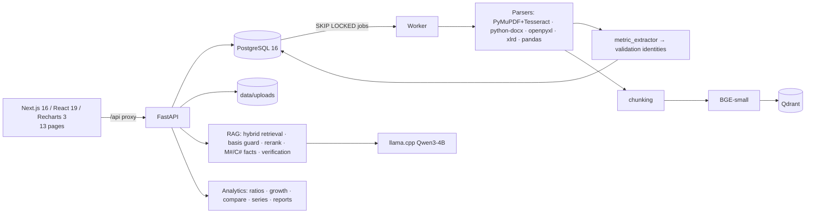

# FinRAG: Product Vision Gap Analysis

**Date:** 2026-11-24 · **Baseline:** branch `claude/amazing-noether-631dkv` at `0012091` (66 backend tests passing; live
end-to-end audit 69/69; see `END_TO_END_DATA_FLOW_AUDIT.md`).

This document compares the code as it stands with the product vision "upload → extract → validate → store → analyse →
**interactive dashboard** → **discuss with AI** → export". Every statement below comes from reading the code, not from the docs.

---

## A. Existing architecture map

| Layer | Modules | Lines |
|---|---|---|
| Extraction | `document_processing/` (parsers, OCR, metadata, chunking, ingestion) | ~1,900 |
| Financial data | `financial_analytics/` (extractor, numbers, validation, ratios, service, comparison, reporting) | ~1,100 |
| RAG | `rag/` + `llm/` | ~700 |
| API | `api/` (auth, documents, analytics, chat, reports, evaluation, system) | ~1,000 |
| Frontend | 13 pages, `components/ui.tsx`, `AppShell` | ~1,500 |

**Data model (16 tables):** `users`, `organisations`, `collections`, `documents` (JSONB detected metadata), `processing_jobs`,
`document_tables`, `document_chunks`, `source_references`, `financial_statements`, `financial_metrics` (raw label, raw value,
Decimal value, normalised value, unit, currency, period label, period end, basis, statement type, method, confidence,
validation status, location), `financial_calculations`, `chat_sessions`, `chat_messages`, `model_configurations`,
`evaluation_runs`, `audit_logs`.

## B. Feature inventory

### Working (tested)
* Upload of PDF/DOCX/XLSX/XLS/CSV, multi-file; signature and structure validation; size/page limits; SHA-256 duplicate
  detection (race-safe); random stored names; owner isolation for all roles; audit log.
* Background worker with job log per stage, retry via reprocess, stale-job recovery, all-or-nothing derived data.
* PDF: text + headings + `find_tables()` ruled tables + text-aligned "virtual" tables with period columns; two-page spreads;
  OCR of image-only pages; page/printed-page/bbox provenance.
* DOCX: headings, paragraphs, tables with table index + row provenance.
* XLSX: every sheet; formulas *and* cached values; uncached formulas reported; sheet + cell provenance. XLS: values.
* CSV: encoding + delimiter detection; row provenance; long/record layouts get column totals and category sums.
* Metadata: organisation, period, fiscal year end, currency, unit, category, each with method/confidence/evidence or "Not detected".
* ~55 canonical metrics with original labels kept; statement type, basis (consolidated/standalone), period per value.
* Validation: 10 accounting identities (hard/soft), sign checks, line-item totals, duplicates; human verify/reject (audited).
* Python Decimal ratios (9 point ratios + growth) on validated/verified inputs only, with formula and cited inputs.
* RAG over the user's documents with citations to page / sheet!cell / table row / CSV row, verification that withholds
  uncited/fabricated-citation answers.
* Compare documents (with compatibility warnings), series charts, Markdown reports.

### Partially working
| Item | What exists | What is missing |
|---|---|---|
| Excel structure | One table per sheet, one header row | Multiple tables per sheet, multi-row headers, merged cells (workbook opened read-only, so merges are invisible), cell number formats (%, dates, currency), total/subtotal flags, cross-sheet formula relationships |
| CSV profiling | Encoding/delimiter | Column type profile, duplicate-row detection, missing-value counts surfaced to the user |
| PDF multi-page tables | Columns detected per page | Header columns reset on every page: a continuation page without a repeated header loses its periods |
| Validation coverage | Balance-sheet, income and attribution identities | Gross profit = revenue − COGS; PBT = PAT + tax as a check on reported tax; cash roll-forward (opening + net change = closing); net change = operating + investing + financing; borrowings total = current + non-current |
| Canonical metrics | ~55 keys | Gross profit, EBIT (currently merged with "operating profit"), opening/closing cash, net change in cash, tax expense used in checks |
| Provenance classes | `extraction_method`, `confidence`, `validation_status`; calculations in their own table | An explicit origin per value (reported / calculated / inferred mapping) visible to the user |
| Analytics UI | Line chart (series), bar chart (compare), ratio tables | See "Not implemented" |
| Reports | Markdown report | Chart data download, dashboard export |

### Not implemented
* **Automatic dashboard**: no KPI generation from available data, no chart selection, no saved dashboard configuration.
* Chart types: grouped/stacked bar, area, pie/donut, waterfall, heatmap, treemap, cash-flow and ratio comparison charts.
* Dashboard interactions: FY/company/document/metric filters, drill-down to source values, chart data download, cross-filtering.
* Cross-document de-duplication for analytics (the same figure printed in two uploaded reports, e.g. prior-year comparatives,
  is shown twice in series; nothing prevents double-counting in an aggregate).
* **Dashboard-aware AI**: chat knows documents only, not the dashboard, filters or chart data; no scenario ("what if revenue
  grows 10%") tool; no executive-summary mode built from KPIs.
* Document replacement (a new version of the same document superseding the old one).

### Incorrect or unreliable
* "Operating profit" pattern also matches the label "EBIT", so two different measures share one key.
* `analytics/series` returns every column of every document; comparative columns repeated across reports appear as
  separate points for the same period.
* The overview page is an operational status page (files, chunks), not a financial overview.

## C. Gap analysis against the vision

| Vision section | Status | Gap to close |
|---|---|---|
| 2 Multi-format pipeline | Mostly met | Excel table boundaries / multi-row & merged headers / number formats / totals / cross-sheet refs; CSV profiling; PDF header carry-over |
| 3A RAG layer | Met | (chunks already carry document, owner, file type, page/sheet/table/row, section context) |
| 3B Structured layer | Mostly met | Explicit value origin; fiscal year per value; EBIT/gross profit/cash roll-forward metrics |
| 4 Validation engine | Partly met | 5 missing identity families (above) |
| 5 Flexible analytics | Partly met | Analysis driven by *available* metrics and periods; single-period overviews; cross-document de-duplication |
| 6 Automatic dashboard | **Missing** | Dashboard builder + UI with KPI cards, 11 chart families, filters, drill-down, downloads |
| 7 AI dashboard conversation | **Missing** | Dashboard context, deterministic calculation/scenario tools, hypothetical labelling |
| 8 Data lifecycle | Mostly met | Saved dashboard configurations; replacement |
| 9 Technology | Fit for purpose | Keep the stack. Recharts already covers bar, line, area, pie, treemap and (via stacked bars) waterfall; a heatmap is a small custom grid. ECharts/Plotly would add 1 MB+ for no missing capability. pdfplumber/Camelot are not needed: PyMuPDF already provides `find_tables()` and word geometry. LlamaIndex would replace a tested custom pipeline without adding a needed feature. |
| 10 Security | Met | Extend isolation tests to the new endpoints |

## D. Recommended architecture and schema changes (additive)

* `financial_metrics`: add `value_origin` (`reported` \| `inferred_mapping`), `fiscal_year` (int, derived deterministically from
  the period), `is_total` (row is a printed total/subtotal). Calculated values stay in `financial_calculations` and in
  dashboard KPIs labelled `calculated`. Source values are never overwritten.
* `dashboards`: id, owner, name, filters (JSONB), layout/chart selection (JSONB), timestamps. Chart datasets are not stored:
  they are reproducible from the saved filters through the dashboard service (a query definition, not a copy).
* `document_tables.file_metadata`-style details (header rows, merged ranges, formats) kept in JSONB on `document_tables`
  and `documents.doc_metadata`.
* New service `financial_analytics/dashboard.py`: one de-duplicated fact set per (organisation, basis, metric, fiscal
  year), KPI builder, chart planner (chooses chart types from data shape), drill-down to source values.
* Chat: `rag/dashboard_context.py` adds `[D#]` dashboard facts and `[H#]` hypothetical scenario results (Python), both
  verifiable like `[M#]`/`[C#]`.

## E. Prioritised roadmap

| Phase | Content | Why this order |
|---|---|---|
| 1 | Excel/CSV/PDF extraction gaps | Better facts feed everything after |
| 2–3 | Value origin, fiscal year, new metrics, 5 new validation families | Dashboards must only show trustworthy, correctly mapped values |
| 4 | Dashboard service + API (KPIs, charts, de-duplication, saved dashboards, CSV export) | Core of the product vision |
| 5 | Dashboard UI (filters, 11 chart families, drill-down, downloads, export) | Visible product |
| 6 | Dashboard-aware chat with calculation and scenario tools | Second key feature; needs 4–5 |
| 7 | Acceptance tests with new test files, screenshots, docs | Proof |

Progress against this roadmap is recorded in `docs/PROGRESS.md` and in the final section of this document.

---

## F. Implementation status (2026-11-24)

| Phase | Delivered | Tests |
|---|---|---|
| 1 Extraction | Excel: several tables per sheet (`tabular.split_blocks`), merged group headers and two-row headers, % and currency number formats, total/subtotal flags, cross-sheet formula links, link cells treated as copies; CSV: column profile (number/date/text/empty), duplicate rows, missing values, consistent-delimiter detection, decimal comma, `#` comment lines, ragged rows (**fixed silent data loss**: a title line made pandas skip every row), record summaries for dated tables of any length; PDF: column headers carried to continuation pages when columns align; unit statements such as "Amounts in USD million" | `test_structure_and_checks.py` |
| 2 Data model | `documents.structure` (JSONB), `financial_metrics.value_origin` / `fiscal_year` / `is_total`, `dashboards` table (migration `b7d4e2a91c05`); basis inherited only when a document is unambiguous | same + `test_dashboard.py` |
| 3 Mapping and validation | Distinct EBIT, gross profit, cash generated from operations, opening/closing cash, net change in cash, explicit short/long-term borrowings; new checks: PBT = PAT + tax, gross profit = revenue − COGS, cash roll-forward (hard), net change = three activities, total borrowings = components; generic "column total" check rewritten to find the actual component rows | same |
| 4 Analytics | `financial_analytics/dashboard.py`: one fact per organisation/basis/metric/year across documents, display unit per organisation, KPIs from available data, calculations from validated inputs only (others listed as pending), chart planner by data shape, gross and EBITDA margins added to the ratio engine; API `/dashboard/build`, `/dashboard/export.md`, `/dashboards` CRUD | `test_dashboard.py` |
| 5 Dashboard UI | `/dashboard`: KPI cards with change and provenance, 10 chart types (bar, grouped/stacked bar, line, area, pie, donut, waterfall, heatmap, treemap), filters (company, fiscal year, basis, document, metric), drill-down to printed value and source location, cross-highlight of a selected year, interactive legend, table view, CSV per chart, Markdown export, print/PDF, saved views, light/dark palette validated for colour-vision deficiency | browser screenshots (`docs/screenshots/`) |
| 6 Dashboard AI | `/dashboard/chat`: server-rebuilt dashboard as `[D#]` sources, Python scenarios as `[H#]`, document passages for explanations, verification of the new citation kinds, conversation stored with citations | `test_dashboard.py` (test double) + live acceptance with the real model |
| 7 Acceptance | `scripts/make_acceptance_files.py`, `scripts/acceptance_run.py`; results in `docs/ACCEPTANCE_TESTS.md` | live run |
